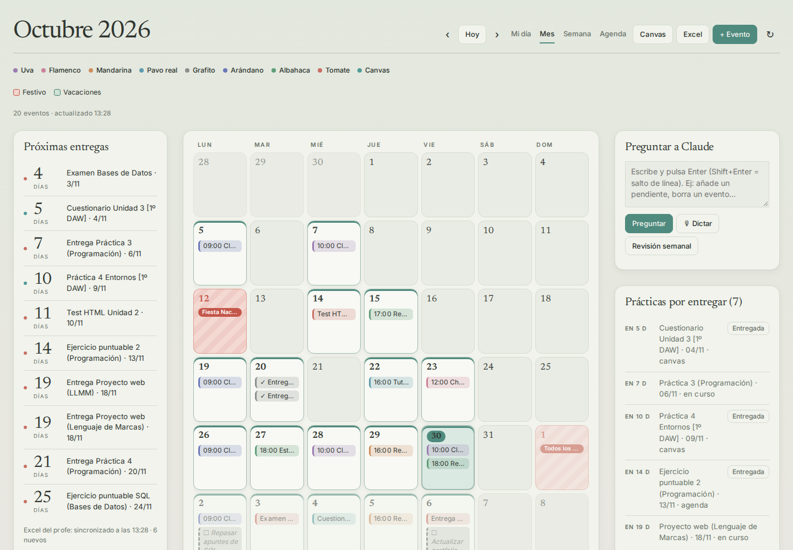
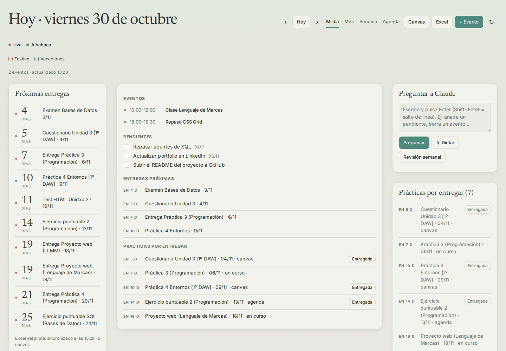
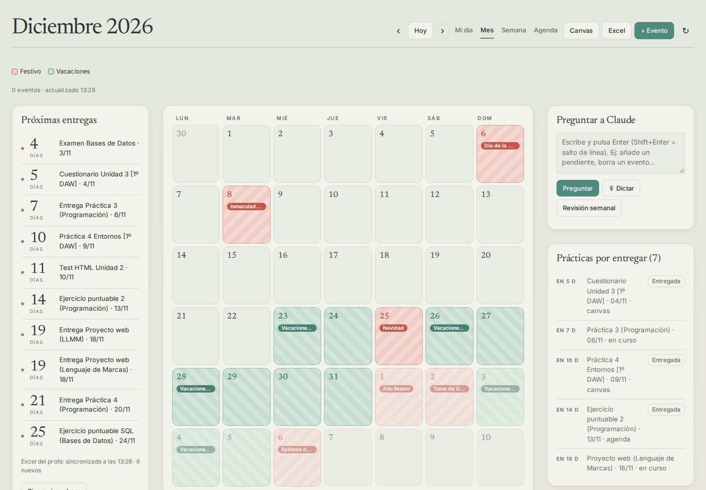
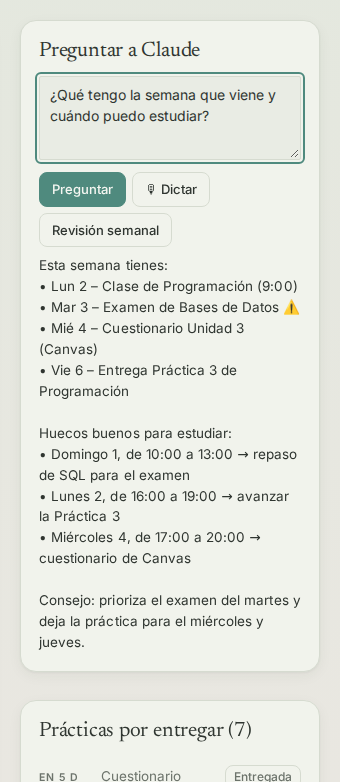
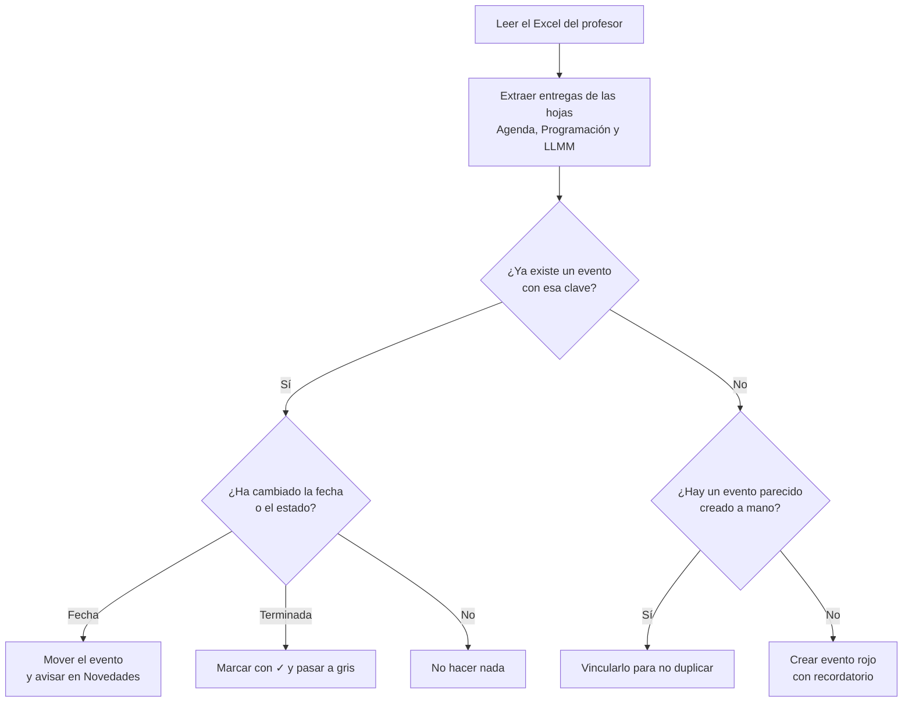

# 📅 Mi calendario

> Panel de organización personal para estudiantes: une **Google Calendar**, **Canvas** y el **Excel de seguimiento del profesor** en una sola página, con un asistente de IA integrado.

**[▶ Probar la demo](https://albertomsevilla.github.io/Mi-calendario/)** · funciona en el navegador con datos de ejemplo, sin instalar nada ni iniciar sesión.

Proyecto propio desarrollado durante **1º de DAW** (Desarrollo de Aplicaciones Web).

---

## Índice

- [El problema](#el-problema)
- [Funcionalidades](#funcionalidades)
- [Capturas](#capturas)
- [Cómo usarla](#cómo-usarla)
- [Tecnologías](#tecnologías)
- [Cómo funciona por dentro](#cómo-funciona-por-dentro)
- [Retos y aprendizajes](#retos-y-aprendizajes)
- [Uso de IA en el desarrollo](#uso-de-ia-en-el-desarrollo)
- [Próximos pasos](#próximos-pasos)
- [Autor](#autor)

---

## El problema

Al empezar el curso, la información que necesitaba para organizarme estaba repartida en **tres sitios distintos**:

| Fuente                      | Qué contiene                               | Problema                         |
| --------------------------- | ------------------------------------------ | -------------------------------- |
| **Canvas** (campus virtual) | Tareas y fechas de entrega                 | Hay que entrar a mirarlo         |
| **Excel del profesor**      | Agenda del curso y estado de cada práctica | No avisa cuando cambia una fecha |
| **Google Calendar**         | Mis eventos personales                     | No sabe nada de los otros dos    |

**Mi calendario** junta las tres fuentes en una sola vista, detecta los cambios por mí y me avisa de lo que tengo que entregar.

---

## Funcionalidades

### 🗓️ Calendario

- [x] Cuatro vistas: **Mi día**, **Mes**, **Semana** y **Agenda** (próximos 30 días)
- [x] Crear, editar y borrar eventos directamente en **Google Calendar**
- [x] Eventos de todo el día o con hora, con descripción y **12 colores**
- [x] **Filtros por color** para mostrar u ocultar tipos de eventos
- [x] Recarga automática al volver a la pestaña y cada 2 minutos

### 🎓 Integración con Canvas

- [x] Importa las tareas del curso desde el calendario de Canvas (en solo lectura)
- [x] Sección de **Novedades**: avisa cuando aparece una tarea nueva o **cambia una fecha de entrega**
- [x] Botón **Entregada** para marcar tareas y lista de entregadas con opción de **deshacer**

### 📊 Sincronización con el Excel del profesor

- [x] Lee las hojas *Agenda*, *Prácticas Programación* y *Prácticas LLMM* (Lenguaje de Marcas)
- [x] Crea automáticamente un evento por cada entrega, en rojo y **con recordatorio**
- [x] Si el profesor **cambia una fecha**, la actualiza en el calendario y lo avisa
- [x] Si una práctica figura como terminada, la marca con **✓** y la pasa a gris
- [x] Evita duplicados aunque el evento se hubiera creado a mano antes
- [x] Se sincroniza sola cada 30 minutos o con el botón **Sincronizar ahora**

### ⏰ Entregas y pendientes

- [x] **Próximas entregas**: cuenta atrás en días de todo lo que vence en los próximos 45 días
- [x] **Prácticas por entregar**: lista unificada (Excel + Canvas) ordenada por fecha
- [x] **Pendientes** con fecha límite opcional, que aparecen también en el calendario

### 🏖️ Festivos y vacaciones

- [x] Festivos nacionales cargados del calendario oficial de Google, más el festivo local de Granada
- [x] Periodos de vacaciones del curso (Navidad y Semana Santa)
- [x] Marcados con **rayado de color** (coral para festivos, verde para vacaciones) y leyenda

### 🤖 Asistente con IA

- [x] Gestión del calendario en **lenguaje natural**: *"crea un evento el jueves a las 17:00"*, *"borra la reunión del lunes"*, *"pon en rojo el examen"*
- [x] **Búsqueda de huecos libres** para estudiar
- [x] **Revisión semanal**: resumen de entregas y propuesta de organización para la semana siguiente
- [x] **Dictado por voz**

### 🎨 Diseño

- [x] Diseño **responsive** (ordenador y móvil)
- [x] Paleta **pastel en verde salvia**, pensada para no cansar la vista
- [x] Días con eventos resaltados y día actual marcado

---

## Capturas

> Las capturas usan **datos de ejemplo** para no mostrar información personal.

| Vista mensual                       | Mi día                    |
| ----------------------------------- | ------------------------- |
|  |  |

| Festivos y vacaciones | Asistente con IA |
|-----------------------|------------------|
|  |  |

---

## Cómo usarla

El código completo está en [`mi-calendario.html`](mi-calendario.html): un único archivo con HTML, CSS y JavaScript.

La aplicación está pensada para ejecutarse como **artifact de Claude** (claude.ai), que es quien le da acceso a Google Calendar, a Microsoft 365 y al asistente de IA. Si abres el archivo directamente en el navegador, verás la interfaz pero sin datos.

Para adaptarla a tu curso, cambia estas variables al principio del script:

| Variable | Qué poner |
|----------|-----------|
| `CANVAS` | El identificador del calendario de Canvas importado en Google Calendar |
| `XLS_URI` | La ruta del Excel de seguimiento en SharePoint |
| `MYROW` | Tus apellidos y nombre, tal como aparecen en el Excel |

---

## Tecnologías

| Tecnología | Uso en el proyecto | Asignatura relacionada |
|------------|--------------------|------------------------|
| **HTML5** | Estructura, formularios y ventana de diálogo (`<dialog>`) | Lenguaje de Marcas |
| **CSS3** | CSS Grid, Flexbox, variables CSS, `color-mix()`, degradados y media queries | Lenguaje de Marcas |
| **JavaScript** (sin frameworks) | Lógica, manipulación del DOM y eventos | Programación |
| **async / await** | Llamadas a las APIs sin bloquear la página | Programación |
| **API de Google Calendar** | Leer, crear, editar y borrar eventos | — |
| **Microsoft 365 / SharePoint** | Lectura del Excel del profesor | — |
| **localStorage** y base de datos | Guardar preferencias, pendientes y estado de las entregas | — |

Todo el proyecto está en **un único archivo HTML**, sin frameworks ni librerías de JavaScript.

---

## Cómo funciona por dentro

Flujo de la sincronización con el Excel del profesor:

Cada evento creado por la sincronización lleva una **clave única** en su descripción (por ejemplo `prog|practica 3`). Así la aplicación sabe qué evento corresponde a cada práctica aunque cambie su fecha o su título.

---

## Retos y aprendizajes

- **Evitar eventos duplicados.** Al principio cada sincronización volvía a crear las mismas entregas. Lo resolví con una clave única por práctica y comparando palabras del título con los eventos ya existentes.
- **Detectar cambios de fecha.** La app guarda una "foto" de las tareas de Canvas y la compara con la siguiente carga para avisar de lo que ha cambiado.
- **Trabajar con fechas en JavaScript.** Eventos de todo el día y con hora, semanas que empiezan en lunes, zonas horarias... Más complicado de lo que parece.
- **Leer datos de un Excel** que no diseñé yo: localizar las columnas por su texto (por ejemplo `Práctica 3 - 20/10/2026`) en lugar de por su posición.
- **Diseño y usabilidad.** Probé varios estilos hasta llegar a una paleta pastel cómoda para usarla a diario, con festivos y vacaciones bien diferenciados.

---

## Uso de IA en el desarrollo

He desarrollado este proyecto con la ayuda de un asistente de IA (**Claude**). Mi trabajo ha sido:

- Detectar el problema y **decidir qué funcionalidades necesitaba**
- **Diseñar** cómo debía verse y comportarse la aplicación
- **Probarla** en mi día a día, encontrar fallos y pedir correcciones
- Iterar sobre el diseño hasta dar con el resultado final

Aprender a trabajar con IA de forma eficaz (explicar bien lo que quiero, revisar lo que genera y corregirlo) forma parte de mi formación como desarrollador.

---

## Próximos pasos

- [x] Versión **demo** con datos de ejemplo para que cualquiera pueda probarla
- [ ] Exportar las entregas a PDF
- [ ] Notificaciones en el navegador antes de cada entrega
- [ ] Estadísticas de entregas a tiempo por asignatura

---

## Autor

**Alberto Martínez Sevilla**
Estudiante de 1º de Desarrollo de Aplicaciones Web (DAW) · Granada

- LinkedIn: [Alberto Martínez Sevilla](https://www.linkedin.com/in/alberto-martínez-sevilla/)
- GitHub: [@Albertomsevilla](https://github.com/Albertomsevilla)
